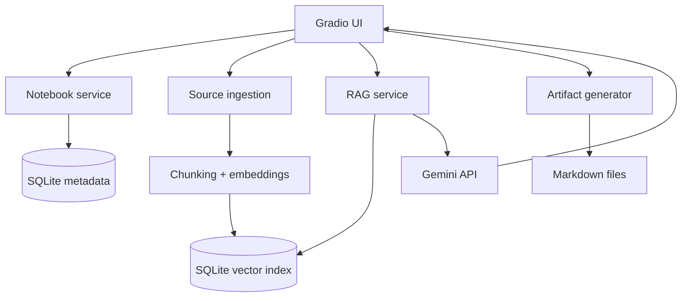

# Architecture

## Modules

| Module | Responsibility |
|---|---|
| `ui.py` | Gradio workflow, validation, error display |
| `storage.py` | Notebook, source, chat, artifact, and evaluation records |
| `ingestion.py` | Extract PDF, PPTX, text, Markdown, and webpage content |
| `text_utils.py` | Normalize and overlap-chunk source text |
| `vector_store.py` | Embeddings, SQLite vector persistence, similarity and MMR retrieval |
| `rag.py` | Context assembly, Gemini prompt, citations, timing |
| `artifacts.py` | Generate and persist `report.md` and `quiz.md` |

## Data flow

1. A user selects a notebook and adds a source.
2. The app extracts and chunks text, creates local embeddings, and stores them in a persistent SQLite vector index.
3. A question retrieves chunks through similarity or MMR.
4. The prompt sends only retrieved context to Gemini and requests inline citations.
5. SQLite saves the conversation and evaluation metrics.
6. Artifact generation uses the notebook's chunks and saves downloadable Markdown.

## Persistence and deployment

SQLite metadata, the SQLite vector index, and generated artifacts share `DATA_DIR`. The Render configuration mounts a persistent disk at `/var/data`. Secrets are environment variables and are never committed. GitHub Actions runs tests, builds the Docker image, and optionally triggers a Render deployment hook.

